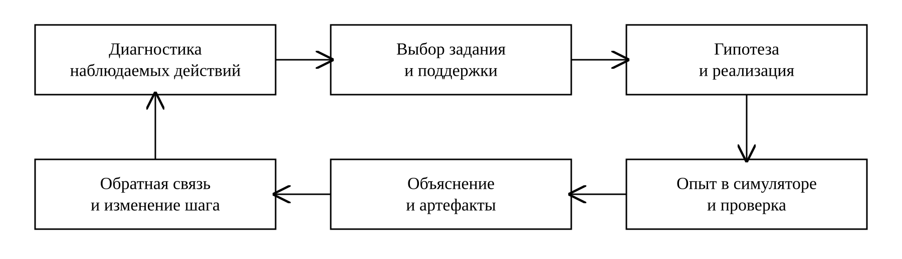

# Дифференцированное обучение алгоритмам и структурам данных на основе компетентностной модели и цифрового симулятора

Горохова Римма Ивановна

**Введение.** Различия в опыте программирования требуют гибкой организации практики при общем целевом результате. Доступность готового кода усложняет оценку самостоятельности. Цель работы – разработать методику обучения алгоритмам и структурам данных, связывающую требования компетентностной модели с заданиями разной сложности, характером помощи и проверяемыми действиями студента.

**Материалы и методы.** Использованы рабочая программа дисциплины на Python, целевая модель выпускника, материалы КРМ и действующий программный пилот. Применены содержательное сопоставление требований, педагогическое проектирование, анализ учебных действий и воспроизводимая проверка демонстрационных сценариев. Дифференциация рассматривается по двум осям: сложность задания и объём поддержки. Единицей анализа служит решение задачи вместе с объяснением, условиями его получения и проверкой переноса.

**Результаты исследования.** Предложена методическая модель, включающая диагностику, выбор задания и помощи, формулирование гипотезы, реализацию, опыт в симуляторе и обратную связь. Разработаны матрица согласования требований, рубрика наблюдаемых действий и правила изменения поддержки. На примерах поиска, сортировки и подсчёта инверсий раскрыто использование банка из 48 заданий по 16 темам. Показано, как журнал связывает версии кода, параметры опыта, контрпримеры и выводы. Разделены автоматическая проверка примеров и преподавательская оценка объяснения алгоритма.

**Обсуждение и заключение.** Результатом является методика с программной поддержкой и воспроизводимыми примерами её применения. Сопоставление кодов разных документов требует содержательной экспертизы. Успешное выполнение тестов не подтверждает всей компетенции. Педагогическая эффективность и возможное сокращение разрыва в подготовке студентов подлежат проверке на следующем этапе. Для него необходимы общий самостоятельный контроль, учёт исходной подготовки и проверка сохранения результата без помощи.

# Введение

Обучение алгоритмам и структурам данных объединяет несколько различных учебных действий: понимание условия, построение способа решения, запись программы, анализ её свойств и обоснование применимости. Трудности начинающего программиста поэтому не сводятся к незнанию синтаксиса. Обзор Ю. Цяня и Дж. Лемана систематизирует заблуждения и затруднения вводного курса, а работа Ю. Сорвы раскрывает значение представления о выполнении программы [1, 2]. Студент может воспроизвести знакомый фрагмент кода, но не объяснить изменение состояния или ошибку на граничном входе. Для преподавателя существенно различать эти ситуации, поскольку одинаковый итог запуска может скрывать разные учебные потребности.

При едином наборе обязательных результатов студенты различаются опытом решения задач, владением математическим аппаратом, темпом чтения кода и способностью контролировать собственное решение. Одинаковое увеличение числа упражнений не отвечает всем этим различиям. Одному студенту требуется трассировка и конкретизация условия, другому – сопоставление алгоритмов, третьему – перенос знакомой идеи в новую постановку. Дифференциация в предлагаемой работе понимается как изменение учебной задачи и поддержки на основании наблюдаемых затруднений. Систематический обзор дифференцированного обучения в среднем образовании показывает необходимость учитывать контекст и конкретные формы организации [3]. Его выводы не переносятся непосредственно на университетский курс программирования; они служат основанием для уточнения проектных условий методики.

Выбор заданий должен согласовываться с тем, что преподаватель собирается оценивать. Принцип конструктивного согласования связывает ожидаемый результат, учебную деятельность и оценивание [4]. Для алгоритмического курса это означает, например, что требование анализировать сложность не может подтверждаться только совпадением ответа с эталоном. Обзор активных методов обучения программированию показывает разнообразие форм учебной работы [5]. Исследования визуализации алгоритмов и подхода PRIMM обосновывают обращение к прогнозированию, исследованию исполнения и обсуждению кода как самостоятельным учебным действиям [6, 7]. В рассматриваемой методике эти действия связываются с сохранением проверяемых результатов работы.

Формирующая обратная связь должна помогать студенту определить ошибку и следующий шаг. Принципиально, на что она направлена: на готовый ответ, на способ действия или на самостоятельную проверку. Обзор В. Шут рассматривает условия использования такой обратной связи [8]. Исследования педагогической поддержки выделяют её соотнесение с текущими потребностями и последующее сокращение помощи [9]. Поэтому одинаковая по сложности задача может предъявляться с разными опорами, а увеличение сложности не обязательно должно сопровождаться уменьшением всей поддержки сразу.

Генеративный ИИ меняет доступность программного продукта, но не устраняет необходимость учиться объяснять и проверять его. Современные обзоры обсуждают возможности языковых моделей, применение ИИ в высшем образовании и ограничения таких решений [10, 11, 12, 13]. Для образовательной рекомендации существенны её объяснимость, прозрачность условий получения результата и возможность проверки преподавателем [14, 15]. Отсюда следует методическое требование различать собственное решение, работу с подсказкой и анализ предложенного варианта, сохраняя происхождение каждого артефакта.

Автоматическая проверка программ полезна для оперативной обратной связи, однако её предмет необходимо явно задавать. Обзор средств автоматического оценивания и обзор генерации обратной связи выделяют различные подходы и проблемы воспроизводимости [16, 17]. Формальная проверка эквивалентности позволяет решать более сильные задачи, чем тестирование отдельных входов, но требует своей модели и инструментария [18]. В описываемом симуляторе такой верификатор не реализован. Его кодовые тесты проверяют наблюдаемое поведение на заданных примерах; выбор структуры данных, обоснование сложности и самостоятельность рассматриваются отдельно.

Работы по поддержке начинающих программистов генераторами кода показывают необходимость исследовать именно условия использования инструмента [19]. Исследование The Widening Gap обращает внимание на различия между способами работы новичков с генеративным ИИ [20]. CodeAid демонстрирует проектирование учебного помощника с учётом потребностей студентов и преподавателя [21]. Исследования диалога с Copilot и упражнений на формулирование запросов расширяют состав учебных действий [22, 23]. Более общие работы обсуждают изменение заданий и оценивания в условиях генерации кода [24, 25]. Эти публикации не доказывают эффективность нашего симулятора; они обосновывают актуальность контролируемого включения помощи и самостоятельной проверки.

В отечественных исследованиях С. А. Румянцев и Ю. В. Полищук рассматривают методическую рамку внедрения ИИ в высшем образовании [26]. А. В. Овсянникова связывает образовательные рекомендации с формированием индивидуальных траекторий и объяснением решений [27]. Для дисциплины алгоритмического цикла важен переход от общего описания персонализации к конкретной процедуре: какое действие предложить студенту, какую помощь разрешить и какое свидетельство получить перед изменением задания.

Цель исследования – разработать методику дифференцированного обучения алгоритмам и структурам данных на основе согласования компетентностных требований, заданий трёх уровней и возможностей цифрового симулятора. Исследовательский вопрос сформулирован следующим образом: как изменять сложность и поддержку, сохраняя общий целевой результат и прослеживаемую связь между учебным действием и его оценкой? В статье представлены результаты педагогического проектирования и технической демонстрации. Проверка влияния методики на результаты обучения выделена в следующий этап.

# Материалы и методы

## Исходные материалы и границы сопоставления требований

Предметную основу составляют рабочая программа «Алгоритмы и структуры данных в языке Python» для направления 01.03.02 «Прикладная математика и информатика», образовательной программы «Прикладное машинное обучение», материалы КРМ версии 3.0, целевая компетентностная модель выпускника и программный модуль учебной практики. Составителем РПД является Р. И. Горохова. В ней представлены 16 тем, включая базовые средства Python, работу с файлами, коллекции, объектно-ориентированное и функциональное программирование, структуры данных, поиск, сортировки, деревья и хеш-таблицы. (источники и версии приведены в source_manifest.json)

Сопоставление документов выполнялось по содержанию требований, а не по сходству обозначений. В РПД указаны ПКН-4 и SS-1; в используемой целевой модели требования к Python представлены, в частности, кодами PL-1.1 и PL-1.2. Формулировки индикаторов SS-1 в документах также не полностью совпадают. Автоматическое переименование ПКН-4 в PL-1 либо отождествление первых индикаторов SS-1 методически необоснованно. В таблице 1 представлены предложения по согласованию отдельных действий; их применение к официальной оценке требует решения владельца образовательной программы.

**Таблица 1. Предложения по содержательному согласованию требований**

| Требование РПД | Ориентир целевой модели | Наблюдаемое действие | Граница интерпретации |
| --- | --- | --- | --- |
| ПКН-4: разработка, отладка и тестирование | PL-1.1 | Реализует алгоритм на Python, находит ошибку, проверяет исправление | Согласование части действий; не тождество кодов компетенций |
| ПКН-4: выбор инструментов Python | PL-1.2 | Обосновывает выбор структуры и средств реализации при заданных ограничениях | Одна задача не подтверждает выбор средств для любого класса ИИ-систем |
| SS-1: работа с этическими и социальными рисками | SS-1.2 | Анализирует последствия использования данных и предложенного решения в контекстной ситуации | Нужен содержательный кейс; тесты алгоритма недостаточны |
| Первый индикатор SS-1 в РПД | SS-1.1 | Сопоставляет формулировки и выделяет различия | Прямое соответствие не установлено; требуется методическая экспертиза |

Методическое сопоставление включает пять операций: выделение действия из требования; уточнение объекта и условий действия; подбор задания; определение наблюдаемого результата; указание ограничений вывода. Например, разработка и отладка алгоритма на Python согласуются с частью PL-1.1, но не подтверждают автоматически способность сопровождать распределённые вычисления из PL-1.4. Аналогично техническая проверка ответа ИИ сама по себе не удостоверяет освоение всей этической компетенции SS-1. Для неё нужны содержательные ситуации выбора и анализа последствий.

## Процедура педагогического проектирования

Исследование имеет проектно-методический характер. Применены содержательный анализ РПД и компетентностных требований, сравнительный анализ научных подходов, декомпозиция учебных действий, проектирование заданий и рубрики, а также воспроизводимая проверка отдельных сценариев симулятора. Литература подбиралась целенаправленно по вопросам дифференциации, поддержки при обучении программированию, формирующей обратной связи, визуализации и применения ИИ. Такой подбор не обозначается систематическим обзором с исчерпывающим поисковым протоколом.

Единицей проектирования выбран учебный эпизод, включающий задачу, разрешённую поддержку, решение, объяснение и проверку. Единицей анализа служит комплект артефактов этого эпизода. Код без сведений об условиях его получения недостаточен для вывода о самостоятельности; объяснение без исполняемого решения недостаточно для проверки реализации. При проектировании связывались обе стороны деятельности.

Для каждой темы определялись общее обязательное действие и возможности его расширения. Затем конструировались задания базового, среднего и продвинутого уровней и варианты поддержки. Проверялось, какое действие действительно наблюдаемо в каждом задании и какие дополнительные вопросы нужны преподавателю. Завершающая операция – описание способа изменения учебного шага по результатам проверки. Эти операции формируют методическую модель; статистическая калибровка её критериев в настоящую работу не входит.

Техническая демонстрация использует опубликованную версию программного модуля и фиксированные параметры. Для опытов сортировки задан один seed и несколько объёмов входа; для анализа ошибочного поиска использован явно подготовленный вариант. Измеряются сравнения ключей в эталонном алгоритме, а не время выполнения программы студента. Ни один технический результат не интерпретируется как показатель успешности группы. (источники и версии приведены в source_manifest.json)

# Результаты исследования

## Модель дифференциации сложности и поддержки

Основной результат – модель организации учебного эпизода по двум независимым осям. Первая ось задаёт сложность и характер действия: выполнение известного способа, выбор и сопоставление способов, исследование и перенос. Вторая ось задаёт поддержку: разобранный пример, частичный каркас, наводящий вопрос, проверочный список либо самостоятельная работа. Уровень задания и объём помощи фиксируются отдельно. Это позволяет дать сложную задачу с адресной опорой студенту, готовому к её предметному содержанию, но испытывающему конкретное затруднение.

Уровни относятся к заданиям в определённой теме. Они не образуют постоянных категорий студентов. Обучающийся может самостоятельно выполнять операции со словарём и одновременно нуждаться в трассировке рекурсивного алгоритма. Изменение маршрута поэтому основывается на локальном профиле действий. Предварительная диагностика включает короткое чтение кода, прогноз результата, объяснение одного шага и задачу на граничный случай. Темп выполнения учитывается как контекст, но не подменяет оценку понимания.

**Таблица 2. Уровни учебного задания и варианты поддержки**

| Уровень | Учебное действие | Возможная поддержка | Проверяемый результат |
| --- | --- | --- | --- |
| Базовый | Выполняет известный способ, объясняет шаг и проверяет простой крайний случай | Разобранный аналог, трасса, каркас функции, вопросы к условию | Работающая реализация и объяснение конкретного шага |
| Средний | Выбирает или сопоставляет способы, исследует условия применимости | Набор входов, вопросы к сравнению, частичная опора в затруднении | Обоснованный выбор и интерпретация измерений |
| Продвинутый | Переносит идею, строит контрпример, исследует ограничение | Постановка, ограничения, согласованные контрольные точки | Новое решение, объяснение переноса и границ вывода |

На базовом уровне сохраняется требование объяснить выбранное действие: наличие образца не превращает работу в механическое копирование. На среднем уровне студент сравнивает варианты и определяет условия выбора, а не просто получает более длинный код. На продвинутом уровне изменяются постановка и доказательные обязанности: требуется перенос, контрпример или исследование ограничения. Количество строк программы не используется как универсальный показатель сложности.

Полный цикл включает диагностику, выбор задания и поддержки, фиксацию гипотезы, реализацию, опыт, объяснение и преподавательскую обратную связь. После опыта студент связывает наблюдения с прогнозом и указывает границы вывода. При затруднении преподаватель меняет конкретную опору: предлагает трассу, уточнение контракта или малый пример. При успешной работе часть опор снимается, а самостоятельность проверяется на другом сопоставимом задании.

Преподавательская обратная связь адресует наблюдаемый дефицит. Если код работает, но студент не объясняет изменение границ поиска, назначается трассировка, а не очередная однотипная задача на написание функции. Если инвариант понятен, но нарушен контракт на повторяющихся элементах, предлагается контрпример с дубликатами. Если затруднение относится к выбору структуры данных, меняются ограничения постановки. Такой порядок делает основание следующего учебного шага понятным студенту.

## Матрица содержания и наблюдаемых результатов

В алгоритмическом модуле подготовлено 48 заданий: по три уровня для каждой из 16 тем РПД. Число заданий характеризует объём исходного банка, а не достаточность измерения всех требований. В таблице 3 приведён фрагмент матрицы, показывающий связь предметного действия с конкретным артефактом. Для официального оценивания необходима экспертиза соответствия задания, индикатора и уровня.

**Таблица 3. Фрагмент матрицы содержания и учебных артефактов**

| Темы РПД | Действие | Проверка | Артефакт |
| --- | --- | --- | --- |
| Управляющие конструкции, функции | Понимает состояние и контракт | Прогноз результата; трассировка; другой допустимый вход | Прогноз, код, объяснение |
| Файлы и исключения | Обрабатывает данные и нештатную ситуацию | Пропуск, повреждённая запись, обоснование обработки ошибки | Контракт и протокол проверки |
| Объекты и коллекции | Выбирает представление и объясняет изменение состояния | Смена ограничения, операция над структурой, сравнение вариантов | Версия решения и обоснование выбора |
| Поиск и сортировки | Объясняет границы и рост числа операций | Контрпример, серия размеров, анализ счётчика | Трасса, измерения, вывод |
| Деревья и хеш-таблицы | Связывает структуру с операциями и ограничениями | Изменение входа, крайний случай, объяснение стоимости | Модель структуры, код и анализ |

Матрица различает результат исполнения и действие, которое стоит за ним. При работе с файлами можно проверить обработку отсутствующего значения на примерах, но обоснование выбранного режима ошибки оценивается отдельно. В задаче на объект студент должен объяснить изменение состояния; в задаче на функцию – контракт и допустимые входы. Для дерева или хеш-таблицы важны не только правильный ответ, но и связь выбранной структуры с операциями и ограничениями.

Включение требований критической работы с ИИ происходит через специальные вопросы к решению. Студент указывает источник варианта, выбирает проверки, ищет контрпример и объясняет исправление. Если обсуждаются персональные данные или последствия автоматизированного решения, используются подготовленные синтетические ситуации. Реальные журналы и идентифицирующие сведения не передаются внешней модели. Анализ этих ситуаций является отдельной частью задания; он не выводится автоматически из успешного теста функции.

## Сценарий поиска и проверка граничного случая

В первом сценарии студент получает отсортированный массив и формулирует прогноз о числе шагов и возможной ошибке границы. Учебный ошибочный вариант использует включённые границы left и right, условие left < right и поиск с досрочным выходом при равенстве. Для массива [2, 4, 6, 8, 10] и цели 10 проверяются середины со значениями 6 и 8. Затем left и right становятся равны 4, цикл завершается, а оставшаяся позиция не проверяется. Алгоритм ошибочно сообщает об отсутствии элемента.

Контрпример содержит точную причину ошибки: одноэлементный интервал не является пустым. Простая замена условия требует согласования с инвариантом и обновлением границ. При включённом интервале допустима проверка left ≤ right; при полуоткрытом интервале [left, right) условие left < right может быть корректным. В симуляторе эталонный поиск позиции вставки использует именно полуоткрытый интервал. Таким образом, сама запись неравенства без определения интервала не свидетельствует об ошибке.

На базовом уровне студент воспроизводит трассу и находит пропущенную позицию. На среднем уровне сопоставляет два соглашения о границах, проверяет пустой массив, отсутствующий элемент и повторяющиеся значения. На продвинутом уровне переносит рассуждение на поиск первого вхождения либо границы вставки и объясняет, какое постусловие требуется после завершения цикла. Для задачи первого вхождения одного досрочного возврата любого найденного индекса недостаточно.

Учебный вариант с ошибкой заранее подготовлен как материал критического анализа в программном модуле. Внешняя языковая модель в этой демонстрации не вызывается; происхождение варианта обозначено явно. В проверке 32 различных целей на массиве из 32 уникальных значений вариант допускает 16 ошибок. Это характеристика данного кода и данного набора, а не оценка частоты ошибок какой-либо LLM или сформированности умения у студентов.

## Сценарий сортировки и интерпретация измерений

Во втором сценарии сопоставляются сортировка вставками и сортировка слиянием на перестановках одного размера. До запуска студент формулирует прогноз о росте числа сравнений. При фиксированных n и seed оба эталона получают одинаковую перестановку; при изменении n формируется новый вход. Для n от 16 до 256 используется seed=42 и счётчик сравнений ключей. Результаты воспроизводятся при неизменной версии генератора и алгоритмов.

**Таблица 4. Воспроизводимая демонстрация сравнения сортировок при seed=42**

| n | C: вставки | C: слияние | C слияния / (n log₂ n) | C вставок / n² |
| --- | --- | --- | --- | --- |
| 16 | 86 | 45 | 0,7031 | 0,3359 |
| 32 | 312 | 125 | 0,7813 | 0,3047 |
| 64 | 1188 | 299 | 0,7786 | 0,29 |
| 128 | 4239 | 732 | 0,817 | 0,2587 |
| 256 | 16513 | 1725 | 0,8423 | 0,252 |

Нормированные показатели C/(n log₂ n) и C/n² помогают сопоставить наблюдения с теоретическими порядками роста. Конечная серия опытов не доказывает асимптотическую оценку и не позволяет по одному малому входу установить лучший алгоритм для любого случая. Студент должен объяснить устройство счётчика, различать сравнение ключей и проверку индекса и указать, какие операции не учитываются. Временные затраты на выделение памяти, работу интерпретатора и копирование списков в приведённой метрике отсутствуют.

На базовом уровне требуется прочитать результат и объяснить один шаг слияния. На среднем – сопоставить несколько объёмов и связать измерения с делением задачи и стоимостью объединения. На продвинутом – исследовать устойчивость, дополнительные затраты памяти и условия применимости сравнения. Проверка устойчивости требует различимых записей с равными ключами; сортировка списка одних чисел не позволяет установить сохранение порядка таких записей. Если в системе проверяются только числовые ответы, этот аспект должен оцениваться дополнительным заданием.

## Сценарий подсчёта инверсий и перенос

Третий сценарий использует определение инверсии как пары индексов i < j, для которой a[i] > a[j]. Условия отличают инверсию от просто двух разных значений и исключают равные элементы. Для массива [3, 1, 2, 1] число инверсий равно 4, для [2, 2, 1] – 2. Эти малые примеры служат проверками понимания контракта и сравнения с прямым перебором.

Средством переноса становится изменение процедуры слияния: если очередной элемент правой части строго меньше текущего элемента левой, добавляется число ещё не перенесённых элементов слева. Студент объясняет, почему эти пары учитываются вместе, почему повторного счёта нет и как обрабатываются равные значения. Обоснование O(n log n) опирается на рекурсивное деление и линейную обработку на каждом уровне. Возврат правильного числа на нескольких входах не заменяет этого обоснования.

Объём поддержки варьируется независимо от целевого действия. Можно предоставить каркас рекурсии и оставить самостоятельными условие сравнения и обновление счётчика; можно предложить только набор контрпримеров; можно поручить разработку с нуля. После совместного разбора самостоятельная проверка проводится на другом входе и с требованием объяснения. Повторение того же варианта сразу после показа решения не используется как независимое подтверждение переноса.

## Рубрика и изменение учебного шага

Для оценивания предложена аналитическая рубрика с шестью признаками: соблюдение контракта и корректность на проверенных входах; работа с граничными случаями; объяснение механизма алгоритма; обоснование сложности; перенос; прозрачность источников помощи. Каждый признак описывается отдельно. Ответ без достаточных данных получает статус «не проверено», а не нулевое значение скрытой способности.

**Таблица 5. Признаки аналитической рубрики**

| Признак | Что наблюдается | Что не следует из наблюдения |
| --- | --- | --- |
| Контракт и результат | Соответствие условию на заданных проверенных входах | Доказательство корректности для всех входов |
| Граничные случаи | Выбор крайних входов и объяснение возможной ошибки | Полнота тестирования по одному найденному примеру |
| Механизм алгоритма | Объяснение состояния, инварианта или шага преобразования | Самостоятельность только по наличию письменного текста |
| Сложность | Обоснование стоимости и точное определение измеряемой операции | Асимптотика по одной короткой серии опытов |
| Перенос | Применение идеи в другом сопоставимом задании с объяснением | Универсальное освоение всех последующих дисциплин |
| Источники помощи | Указание эталона, подсказки, предложенного варианта и характера использования | Независимый контроль по одной самоотметке студента |

Для выбора следующего шага не используется компенсирующая сумма, при которой удачный внешний вид программы перекрывает непонимание алгоритма. Решение преподавателя основывается на сочетании необходимых действий для данной темы. Если не подтверждён контракт, назначается уточнение условия и малые примеры. Если контракт соблюдён, но объяснение отсутствует, назначается разбор исполнения. Если объяснение и граничные случаи освоены, предлагается задача переноса с явно указанным режимом помощи. Это методические правила для апробации, а не статистически откалиброванная шкала компетентности.

Правило перехода имеет локальный характер. Студент может продолжить изучение материала при необходимости дополнительной практики; ознакомительный доступ и признание результата разделяются. Смена уровня не является административным переводом между курсами. Итоговую аттестацию преподаватель проводит по действующей РПД, а не по числу событий в симуляторе.

## Журнал и воспроизводимость учебного эпизода

В программном модуле сохраняются гипотеза, версия кода, объяснение, заявленный режим помощи, параметры опыта, сравнение и преподавательский отзыв. Текстовый протокол связывается с сохранённой попыткой и получает контрольную сумму. История позволяет восстановить последовательность: какой вариант был создан до просмотра сравнения, какие параметры использовались и какой вывод сформулирован. При этом контрольная сумма подтверждает неизменность текста, но не его истинность или авторство.

Журнал организован по дисциплинам. События запуска и предварительные результаты проверки в браузере отделены от оценок и контрольных исходов. Сохранённая отметка «самостоятельно» является заявлением, которое преподаватель при необходимости проверяет объяснением или дополнительным заданием. Технический администратор обслуживает доступ и данные; преподаватель оценивает работу; тьютор поддерживает учебный процесс; методист и руководитель программы рассматривают и утверждают связи содержания.

Воспроизводимый протокол демонстрационного опыта включает версию программного модуля, вход, seed, определение метрики и первичный результат. Для сортировки сохранены исходный алгоритм и параметры пяти запусков, для ошибочного поиска – код и контрпример. Код воспроизведения и данные отделены от ранее подготовленных исследований междисциплинарной системы. Реальные сведения об успеваемости и персональные данные студентов при подготовке статьи не использовались.

# Обсуждение и заключение

Предлагаемая методика конкретизирует дифференцированное обучение на уровне наблюдаемого действия и способа его проверки. Её отличие от простого распределения задач по трудности состоит в отдельном управлении поддержкой и в требовании сохранять объяснение результата. Концепция согласуется с исследовательскими направлениями конструктивного согласования, формирующей обратной связи и педагогической поддержки, но не претендует на замену этих подходов. Собственный результат работы – их предметная операционализация для курса алгоритмов и структур данных и описание её программного сопровождения.

Разделение двух осей позволяет избежать закрепления студентов в неизменных группах по способности. Сложный алгоритм может изучаться с опорой на трассу, тогда как простая задача может использоваться для самостоятельной контрольной проверки. Значение имеет адресность опоры. Избыточная помощь способна скрыть дефицит, а преждевременное снятие всех опор – затруднить продвижение. Предлагаемый цикл предусматривает объяснение оснований выбранной поддержки и её пересмотр по результатам конкретного эпизода.

Симулятор обеспечивает наблюдение и фиксацию результатов, но педагогическую функцию получает через задание. Трасса полезна, если студент прогнозирует изменение состояния и объясняет расхождение; счётчик сравнений – если заранее определена метрика; предложенный вариант кода – если требуется контрпример и проверка исправления. Просмотр анимации, копирование результата и количество запусков не рассматриваются как достаточные критерии. Для преподавателя журнал является источником вопросов к работе, а не автоматическим заключением о компетентности.

Ограничения исследования связаны с его проектным характером. Рубрика и правила изменения поддержки ещё не проверены на согласованность оценок нескольких преподавателей и не откалиброваны на сопоставимых контрольных заданиях. Согласование РПД и целевой модели остаётся содержательной процедурой, особенно при разных кодах и формулировках индикаторов. Банк из 48 заданий не является доказательством полного покрытия всех компетенций программы. Демонстрационные числа характеризуют исполнение конкретных алгоритмов; они не позволяют оценить влияние методики на учебные достижения.

Следующим этапом станет педагогический эксперимент. Рабочая гипотеза состоит в сокращении отставания менее подготовленных студентов по общему самостоятельному контролю при сохранении возможностей развития более подготовленных. До начала исследования необходимо определить критерии начальной подготовки, сопоставимые условия, единый контроль без помощи и отложенную проверку, а также способ учёта исходных различий. Сокращение разброса результатов само по себе недостаточно: оно может возникнуть и при снижении достижений сильной части группы. Поэтому предполагается раздельно анализировать уровень результата, динамику исходных подгрупп и сохранение умения без поддержки.

Разработанная методика связывает компетентностные требования, задания трёх уровней, вариативную поддержку, исследовательский опыт и проверяемые артефакты. На примерах поиска, сортировки и подсчёта инверсий показано, как студент переходит от получения ответа к объяснению и переносу способа решения. Программный модуль обеспечивает регистрацию такого процесса. Основанием для последующего решения о внедрении станут методическая экспертиза и педагогическая проверка; настоящая статья предоставляет для них конкретную модель и воспроизводимые материалы.

# Список литературы

1. Qian Y., Lehman J. Students’ Misconceptions and Other Difficulties in Introductory Programming: A Literature Review. ACM Transactions on Computing Education. 2017;18(1):Article 7, 1-24. https://doi.org/10.1145/3077618.

2. Sorva J. Notional machines and introductory programming education. ACM Transactions on Computing Education. 2013;13(2):Article 8, 1-31. https://doi.org/10.1145/2483710.2483713.

3. Smale-Jacobse A.E., Meijer A., Helms-Lorenz M., Maulana R. Differentiated Instruction in Secondary Education: A Systematic Review of Research Evidence. Frontiers in Psychology. 2019;10:2366. https://doi.org/10.3389/fpsyg.2019.02366.

4. Biggs J. Enhancing teaching through constructive alignment. Higher Education. 1996;32(3):347-364. https://doi.org/10.1007/bf00138871.

5. Calderon I., Silva W., Feitosa E. Active Learning Methodologies for Teaching Programming in Undergraduate Courses: A Systematic Mapping Study. Informatics in Education. 2024;23(2):279-322. https://doi.org/10.15388/infedu.2024.11.

6. Hundhausen C.D., Douglas S.A., Stasko J.T. A Meta-Study of Algorithm Visualization Effectiveness. Journal of Visual Languages & Computing. 2002;13(3):259-290. https://doi.org/10.1006/jvlc.2002.0237.

7. Sentance S., Waite J., Kallia M. Teaching computer programming with PRIMM: a sociocultural perspective. Computer Science Education. 2019;29(2-3):136-176. https://doi.org/10.1080/08993408.2019.1608781.

8. Shute V.J. Focus on Formative Feedback. Review of Educational Research. 2008;78(1):153-189. https://doi.org/10.3102/0034654307313795.

9. van de Pol J., Volman M., Beishuizen J. Scaffolding in Teacher–Student Interaction: A Decade of Research. Educational Psychology Review. 2010;22(3):271-296. https://doi.org/10.1007/s10648-010-9127-6.

10. Kasneci E., Sessler K., Küchemann S., Bannert M., Dementieva D., Fischer F., et al. ChatGPT for good? On opportunities and challenges of large language models for education. Learning and Individual Differences. 2023;103:102274. https://doi.org/10.1016/j.lindif.2023.102274.

11. Ouyang F., Zheng L., Jiao P. Artificial intelligence in online higher education: A systematic review of empirical research from 2011 to 2020. Education and Information Technologies. 2022;27(6):7893-7925. https://doi.org/10.1007/s10639-022-10925-9.

12. Crompton H., Burke D. Artificial intelligence in higher education: the state of the field. International Journal of Educational Technology in Higher Education. 2023;20(1):22. https://doi.org/10.1186/s41239-023-00392-8.

13. Lo C.K. What Is the Impact of ChatGPT on Education? A Rapid Review of the Literature. Education Sciences. 2023;13(4):410. https://doi.org/10.3390/educsci13040410.

14. Khosravi H., Shum S.B., Chen G., Conati C., Tsai Y.S., Kay J., et al. Explainable Artificial Intelligence in education. Computers and Education: Artificial Intelligence. 2022;3:100074. https://doi.org/10.1016/j.caeai.2022.100074.

15. Yan L., Sha L., Zhao L., Li Y., Martinez‐Maldonado R., Chen G., et al. Practical and ethical challenges of large language models in education: A systematic scoping review. British Journal of Educational Technology. 2024;55(1):90-112. https://doi.org/10.1111/bjet.13370.

16. Messer M., Brown N.C.C., Kölling M., Shi M. Automated Grading and Feedback Tools for Programming Education: A Systematic Review. ACM Transactions on Computing Education. 2024;24(1):Article 10, 1-43. https://doi.org/10.1145/3636515.

17. Kumar S.S., Lones M.A., Maarek M., Zantout H. Navigating the Landscape of Automated Feedback Generation Techniques for Programming Exercises. ACM Transactions on Computing Education. 2025;25(4):Article 54, 1-29. https://doi.org/10.1145/3764593.

18. Milovančević D., Chassot S., Bucev M., Wojnarowski M., Kunčak V. Formal Autograding in a Classroom (Extended Version). ACM Transactions on Programming Languages and Systems. 2026;48(3):Article 15, 1-26. https://doi.org/10.1145/3828727.

19. Kazemitabaar M., Chow J., Ma C.K.T., Ericson B.J., Weintrop D., Grossman T. Studying the effect of AI Code Generators on Supporting Novice Learners in Introductory Programming. Proceedings of the 2023 CHI Conference on Human Factors in Computing Systems. 2023:1-23. https://doi.org/10.1145/3544548.3580919.

20. Prather J., Reeves B.N., Leinonen J., MacNeil S., Randrianasolo A.S., Becker B.A., et al. The Widening Gap: The Benefits and Harms of Generative AI for Novice Programmers. Proceedings of the 2024 ACM Conference on International Computing Education Research - Volume 1. 2024:469-486. https://doi.org/10.1145/3632620.3671116.

21. Kazemitabaar M., Ye R., Wang X., Henley A.Z., Denny P., Craig M., et al. CodeAid: Evaluating a Classroom Deployment of an LLM-based Programming Assistant that Balances Student and Educator Needs. Proceedings of the CHI Conference on Human Factors in Computing Systems. 2024:1-20. https://doi.org/10.1145/3613904.3642773.

22. Denny P., Kumar V., Giacaman N. Conversing with Copilot: Exploring Prompt Engineering for Solving CS1 Problems Using Natural Language. Proceedings of the 54th ACM Technical Symposium on Computer Science Education V. 1. 2023:1136-1142. https://doi.org/10.1145/3545945.3569823.

23. Denny P., Leinonen J., Prather J., Luxton-Reilly A., Amarouche T., Becker B.A., et al. Prompt Problems: A New Programming Exercise for the Generative AI Era. Proceedings of the 55th ACM Technical Symposium on Computer Science Education V. 1. 2024:296-302. https://doi.org/10.1145/3626252.3630909.

24. Becker B.A., Denny P., Finnie-Ansley J., Luxton-Reilly A., Prather J., Santos E.A. Programming Is Hard - Or at Least It Used to Be: Educational Opportunities and Challenges of AI Code Generation. Proceedings of the 54th ACM Technical Symposium on Computer Science Education V. 1. 2023:500-506. https://doi.org/10.1145/3545945.3569759.

25. Prather J., Denny P., Leinonen J., Becker B.A., Albluwi I., Craig M., et al. The Robots Are Here: Navigating the Generative AI Revolution in Computing Education. Proceedings of the 2023 Working Group Reports on Innovation and Technology in Computer Science Education. 2023:108-159. https://doi.org/10.1145/3623762.3633499.

26. Румянцев С.А., Полищук Ю.В. Искусственный интеллект в высшем образовании и психологическом консультировании: методическая рамка внедрения. Цифровые решения и технологии искусственного интеллекта. 2026;2(2):6-15. https://doi.org/10.26794/3030-7097-2026-2-2-6-15.

27. Овсянникова А.В. Интеллектуальные рекомендательные системы в образовании. Алгоритмы подбора индивидуальных траекторий обучения. Цифровые решения и технологии искусственного интеллекта. 2026;2(2):16-24. https://doi.org/10.26794/3030-7097-2026-2-2-16-24.
