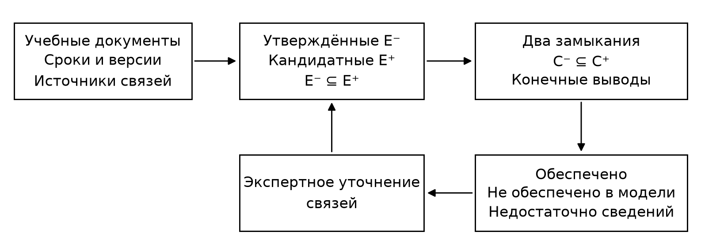

УДК 004.822:378.014

# Модель и алгоритм проверки структурной согласованности междисциплинарной образовательной программы

П. В. Никитин

Финансовый университет при Правительстве Российской Федерации, Москва, Россия

Аннотация. Предложена модель проверки структурной обеспеченности результатов междисциплинарной образовательной программы. В отличие от наличия отметки в матрице компетенций, обеспеченность определяется существованием конечного вывода, который связывает предпосылки, учебные модули и запланированный контроль с требуемыми уровнями индикаторов, сроками и версиями требований. Программа представляется ориентированным гиперграфом с конъюнктивными входами. При неполной разметке вычисляются нижнее и верхнее замыкания, позволяющие различать обеспеченность, необеспеченность в заданном пространстве допустимых дополнений и недостаточность сведений. Доказаны корректность критерия и возможность пересчёта только области влияния изменений. Разработаны проверяемые свидетельства вывода и блокировки. Реализация проверена независимым перебором на 120 малых моделях, включающих 1920 допустимых дополнений, а также на 360 контролируемых примерах. Проведено сравнение полного и локального пересчёта для гиперграфов до 20 тысяч вершин. На фрагменте реального учебного плана показано отделение документально установленных связей от авторских предположений. Результаты относятся к формальной структуре программы и вычислительным свойствам реализации; педагогическая эффективность и фактическое освоение компетенций не оценивались.

Ключевые слова: моделирование образовательных программ, ориентированный гиперграф, структурная согласованность, междисциплинарное обучение, неполные данные, инкрементальное обновление, проверка моделей, прослеживаемость требований

## A Model and Algorithm for Verifying the Structural Consistency of an Interdisciplinary Curriculum

Petr V. Nikitin

Financial University under the Government of the Russian Federation, Moscow, Russian Federation

Abstract. Purpose. This study addresses the verification of whether a fixed interdisciplinary curriculum structurally provides the teaching and assessment opportunities required by its competency framework. The objective is to distinguish an explicit derivation of a required outcome from a mere curriculum-to-competency association. Methods. The curriculum is compiled into a finite directed hypergraph whose vertices distinguish competency indicators, proficiency levels, teaching and assessment states, time points, and requirement versions. Conjunctive prerequisites are represented by single-head rules. Approved and candidate annotations define lower and upper rule sets. Least fixed points provide a three-valued decision under explicitly stated assumptions about admissible completions. A local update procedure recomputes the forward influence region of edited rules. Results. Correctness arguments are provided for the decision criterion, derivation certificates, blocked-set certificates, and local recomputation. An independent truth-assignment oracle verified 1920 completions of 120 small models. Additional checks covered 962 updates, 480 metamorphic transformations, and 360 controlled cases. Timing measurements on graphs with up to 20000 vertices demonstrate the benefit of small influence regions and the overhead of local processing when most vertices are affected. A six-discipline curriculum fragment illustrates the separation of documentary evidence from proposed annotations. Conclusions. The method supports explainable structural auditing and identifies missing annotations without interpreting them as proven curriculum defects. The experiments establish computational properties within the specified model; they do not establish student learning gains or validate the completeness of the expert annotation catalogue.

Keywords: curriculum modelling, directed hypergraph, structural consistency, interdisciplinary learning, incomplete information, incremental update, model verification, requirements traceability

## Введение

Матрица компетенций не показывает, созданы ли предпосылки для последующих модулей и предусмотрен ли контроль до требуемого срока. Например, наличие программирования и баз данных в плане не доказывает, что работа со структурами данных подготовлена до задания по индексированию. Проверка зависит также от соответствия оценочной рубрики действующей версии требований.

Анализ связей внутри учебного плана развивается в рамках curricular analytics. Социально-сетевое представление позволяет исследовать интеграцию дисциплин и информационную основу решений о программе [1]. В моделях сетей пререквизитов изучаются структурные свойства учебных планов [2], включая сравнение сетей нескольких университетов и характеристики значимости курсов [3]. Графы знаний используются для построения персональных учебных путей [4]. Современные исследования сопоставления учебных документов и компетенций показывают, что детальная разметка требует содержательной интерпретации и не сводится к поиску совпадающих слов [5]. Следовательно, задача автоматического получения связей должна быть отделена от задачи формальной проверки уже заданных связей.

Структурная согласованность определяется для выбранного состава модулей и фиксированного расписания: все целевые состояния должны иметь конечные допустимые выводы из входных условий. Проверка устанавливает формальное обеспечение обучения и контроля, а не гарантирует достижение результата каждым обучающимся.

Цель исследования – разработать объяснимый критерий такой обеспеченности при неполной разметке и алгоритм его обновления после изменения программы. Научный результат состоит в согласованной предметной спецификации состояний, сроков и версий, трёхзначном критерии для заданного множества дополнений, а также доказанном правиле локального пересчёта. Само применение гиперграфа, логики Хорна или нижних и верхних приближений не заявляется как новый математический аппарат.

## Предпосылки и границы предлагаемой модели

Прослеживаемость связывает требования с реализующими и проверяющими их артефактами [6]. Граф знаний предоставляет средство представления типизированных объектов и отношений [7], однако факт наличия отношения ещё не определяет семантику совместного выполнения предпосылок. Для условия «требуются и дискретная математика, и программирование» два обычных ребра достижимости приводят к неверной интерпретации «достаточно любого из двух условий». Ориентированные гиперграфы позволяют явно сохранить совместность входов [8]. Конечный положительный вывод в такой модели соответствует вычислению следствий пропозициональных правил Хорна, для которых известны линейные алгоритмы [9].

Неопределённость разметки трактуется через множество допустимых дополнений исходных данных. Это связано с общей проблематикой неполной информации в базах данных [10]. Здесь используется ограниченный положительный случай: неизвестным является наличие отдельных правил из конечного каталога, причём все их подмножества допустимы. Данное ограничение обеспечивает точность вывода по двум крайним моделям. Взаимоисключающие элективы и связанные логическими ограничениями варианты требуют другой постановки и в теоремы ниже не входят.

Обновление следствий после изменения исходных данных исследуется при инкрементальном поддержании представлений [11] и материализации Datalog [12]. Предлагаемый пересчёт области влияния не претендует на замену этих общих методов. Его назначение – получить простую проверяемую процедуру для конечной предметной модели, устойчивую к удалению последней опоры циклических зависимостей. Сравнение выполняется с полным пересчётом той же реализации; преимущество перед промышленными системами логического вывода не исследуется.

Средства проверки графовых ограничений [13; 14] применимы к контролю метаданных. Однако допустимость записи и выводимость состояния различаются: запись о контроле с корректными полями может оставаться недостижимой, а наличие пути не разрешает связь несовместимых версий.

## Формальное представление программы

Фиксируются выбранные обязательные и элективные модули, календарь и версия требований. Для индикатора k задаются уровни ℓ; метки 1, 2, 3 обозначают базовый, средний и продвинутый уровни требований, а не оценку студента. Координата t задаёт контрольную точку: границу семестра либо более короткого модуля.

Атом состояния имеет вид, заданный формулой (1).

ξ = (k, ℓ, σ, t, v)  (1)

Здесь σ принимает значения teach и assess. Первое означает, что в спецификации предусмотрена возможность формирования данного результата; второе – что предусмотрен согласованный с ним контроль. Поле v содержит версию требования, к которой относится состояние. Вершины могут также представлять вспомогательные факты: наличие модуля в выбранной программе или явно принятую входную предпосылку. Такие вершины имеют отдельный тип и не смешиваются с индикаторами компетенций.

Конечное множество вершин обозначим V. Правило e имеет множество входов Iₑ и единственный выход oₑ. Семантика правила конъюнктивна: выход может быть выведен только после вывода всех входов. Несколько правил с одинаковым выходом задают альтернативные способы обеспечения результата. Для входных условий определяется множество C₀. Его элементы являются предположениями проверки; они не означают, что каждый поступивший студент уже успешно прошёл входную диагностику.

Компиляция исходных записей в правила подчиняется следующим ограничениям. Результат входного модуля должен быть доступен не позднее начала использующего его модуля. Выход относится к моменту завершения модуля или к отдельно размеченной внутренней контрольной точке. Если два результата записаны в одном семестре, допустимость их последовательного использования требует более подробного календаря. Простое совпадение номера семестра такую последовательность не подтверждает.

Переход между уровнями допускается только по явно заданной связи. Из наличия базового уровня не следует наличие среднего; обратный переход также не выводится автоматически, если экспертная модель не содержит отношения включения. Для разных версий требуется утверждённое правило соответствия. Перенос обеспеченности между временными точками представляется отдельным правилом сохранения, действующим в установленном интервале. Это правило описывает сохранение планового обеспечения и не является моделью забывания знаний.

Правило контроля должно ссылаться на учебное состояние, задание или оценочное мероприятие, рубрику, индикатор и уровень. Привязка «дисциплина – компетенция» без задания и рубрики не создаёт состояния assess. Входы многопредметного модуля объединяются в одном правиле. Если допустимы разные наборы предпосылок, для каждого набора создаётся отдельное правило. Нарушающие жёсткие ограничения записи исключаются из обеих вычисляемых моделей и сохраняются в журнале ошибок компиляции.

Запись содержит идентификатор, источник, координату в документе, версию, автора и статус согласования. Фиксация происхождения соответствует назначению PROV-DM [15]; полная реализация стандарта не выполнялась. Идентификатор правила обозначает всё его содержание: изменение входов, срока или версии представляется удалением старого и добавлением нового правила.

Подтверждённые правила образуют множество E⁻, а полный конечный каталог разрешённых кандидатов – E⁺. Возможные уточнения программы определяются интервалом (2).

E⁻ ⊆ E ⊆ E⁺  (2)

Все множества из этого интервала считаются допустимыми. В частности, нижняя и верхняя модели должны сами быть допустимыми вариантами. Это существенная предпосылка: если выбор одной связи запрещает другую, верхняя модель может объединить несовместимые альтернативы, и сформулированный ниже критерий утратит точность. Выбор элективов поэтому фиксируется до проверки. Неизвестные входные предпосылки должны быть вынесены в явный каталог допущений, а не молча добавлены в C₀.

Целевое множество R состоит из состояний assess для индикаторов, уровней, контрольных сроков и версий, выбранных в задании на аудит. Требование обеспечить результат к сроку задаётся соответствующей вершиной; допустимый перенос с более раннего срока отражается правилами сохранения. Так компиляция временных ограничений предшествует вычислению замыкания, а алгоритм не подменяет календарную проверку обычным порядком обхода вершин.

## Критерий обеспеченности и проверяемые свидетельства

Для фиксированного множества правил E определим последовательность (3). Её стабилизировавшееся значение обозначим cl_E(C₀), где индекс E относится к набору правил.

Cᵣ₊₁ = Cᵣ ∪ {oₑ : e ∈ E, Iₑ ⊆ Cᵣ}; cl_E(C₀) = ⋃ᵣ≥₀ Cᵣ  (3)

Поскольку V конечно и последовательность монотонна, стабилизация происходит не более чем после |V| строгих расширений. Последовательные сканирования всех правил подходят для определения семантики, однако для реализации далее используется очередь. Обозначим C⁻ и C⁺ замыкания нижней и верхней моделей соответственно. В силу положительности правил имеет место включение (4).

C⁻ = cl_E⁻(C₀) ⊆ cl_E(C₀) ⊆ cl_E⁺(C₀) = C⁺  (4)

Утверждение 1. Состояние принадлежит cl_E(C₀) тогда и только тогда, когда оно имеет конечный вывод из C₀ по правилам E. Замыкание является наименьшим множеством, содержащим C₀ и замкнутым относительно E.

Доказательство. Для каждого состояния, добавленного на шаге r + 1, существует правило, все входы которого уже добавлены к шагу r. Индукция по номеру шага даёт конечное дерево вывода. В обратную сторону проводится индукция по высоте конечного вывода: его листья находятся в C₀, а выход каждого внутреннего правила появляется после всех его входов. Если множество содержит C₀ и замкнуто относительно правил, индукция по r показывает, что оно содержит каждый элемент последовательности (3). Следовательно, оно содержит её предел. Это доказывает и минимальность.

Определим три результата проверки по формуле (5). Англоязычные обозначения в формуле совпадают с кодами результатов программной реализации.

S(R): ensured, если R ⊆ C⁻; not_ensured, если R ⊈ C⁺; undetermined в остальных случаях  (5)

Статус ensured означает «структурно обеспечено при любом допустимом дополнении». Статус not_ensured означает «не обеспечено ни при одном дополнении из заданного каталога». Статус undetermined означает «сведений недостаточно для однозначного вывода». Отрицательный результат относится к определённому пространству дополнений. Он не доказывает невозможность обеспечить компетенцию другими, ещё не включёнными в каталог средствами.

Утверждение 2. При допущениях (2) критерий (5) является точным относительно всех допустимых дополнений.

Доказательство. Если R содержится в C⁻, то по монотонности оно содержится в замыкании любого E из интервала (2). Если R не содержится в C⁺, хотя бы один целевой атом отсутствует даже в максимальном замыкании и не выводится ни в одном допустимом дополнении. В оставшемся случае нижняя модель не обеспечивает R, а верхняя обеспечивает. Обе модели допустимы, поэтому существуют дополнения с разными ответами. Таким образом, третий результат не является эвристическим уровнем уверенности, а точно выражает неоднозначность заданного семейства моделей.

Положительное свидетельство сохраняет одно правило при первом добавлении каждой вершины и отметки исходных фактов. Порядок обнаружения задаёт ациклическую структуру даже при циклах в полном гиперграфе. Независимый проверяющий алгоритм проверяет правила и завершение ветвей в C₀. Поиск кратчайшего вывода не выполняется.

Отрицательное свидетельство представляет собой множество B, определённое и ограниченное формулой (6).

B = V ∖ C⁺; B ∩ C₀ = ∅; B ∩ R ≠ ∅; ∀ e ∈ E⁺: oₑ ∈ B ⇒ Iₑ ∩ B ≠ ∅  (6)

Множество B не содержит входных фактов, пересекается с целями, и любое правило с выходом в B имеет вход в B. Поэтому первый элемент B не может появиться в конечном выводе. Условия проверяются непосредственно по B и правилам. Минимальность свидетельства блокировки не утверждается.

Для неопределённого результата вывод из C⁺ содержит хотя бы одно неподтверждённое правило, иначе соответствующий целевой атом принадлежал бы C⁻. В отчёт включаются идентификаторы таких правил и их источники. Полученный набор помогает планировать экспертную разметку, но не объявляется минимальным набором уточнений. На рис. 1 показано разделение документальных данных, вычислительного вывода и экспертного решения.

## Алгоритмы полного и локального пересчёта

Полное замыкание вычисляется прямым выводом. Для каждого активного правила хранится счётчик ещё не полученных входов. В очередь сначала помещаются различные элементы C₀; правила с пустым входом срабатывают сразу. При извлечении вершины просматриваются содержащие её входные инцидентности. Счётчик соответствующего активного правила уменьшается на единицу. При достижении нуля выход добавляется, если он ещё не получен, и помещается в очередь. Повторно одна вершина не обрабатывается.

Пустой вход допустим для безусловного факта, но не для правила контроля. Входы правила не повторяются; дублирующие правила имеют разные идентификаторы источников.

Известный принцип счётчиков для правил Хорна [9] обеспечивает оценку (7) для подготовленного индекса инцидентности. Обозначение L соответствует общему числу входных инцидентностей в индексируемой модели.

L = ∑ₑ∈E |Iₑ|; T = O(|V| + |E| + L)  (7)

Память имеет тот же порядок. При объединённом индексе верхней модели время включает просмотр индексируемых, в том числе неактивных инцидентностей. Оценка не включает экспертное получение связей, обработку текста документов и построение всех сочетаний элективов. Для определения трёхзначного статуса выполняются два таких вывода. При необходимости положительное свидетельство сохраняется вместе с результатом каждого вывода.

Пусть меняется множество правил, входных условий или их метаданных. Старый и новый варианты вложим в общее конечное множество вершин и правил. Индекс содержит объединение старых и новых правил. Событие изменения передаёт полный список добавленных и удалённых идентификаторов. Сначала формируется D₀ из выходов изменённых правил и изменившихся входных фактов. Область влияния D задаётся формулой (8), где F – объединение старого и нового наборов активных правил.

Dᵣ₊₁ = Dᵣ ∪ {oₑ : e ∈ F, Iₑ ∩ Dᵣ ≠ ∅}; D = ⋃ᵣ≥₀ Dᵣ  (8)

На данном этапе обычная проекция «любой вход влияет на выход» корректна: она задаёт консервативную область возможных изменений, а не доказывает достижимость. Затем все вершины D пересчитываются с нуля по новым правилам. Входы вне D считаются доступными только при принадлежности старому замыканию. Входы внутри D учитываются исключительно после их нового вывода. Из старого результата удаляются потерянные элементы D и добавляются вновь полученные.

Утверждение 3. Описанная процедура даёт то же замыкание, что полный вывод по новому набору правил и новым входным фактам.

Доказательство. Вне D не меняется исходная принадлежность к входным фактам. Правило с выходом вне D не может быть изменённым, поскольку его выход тогда находился бы в D₀. Оно также не имеет входа в D, иначе его выход был бы включён в D при вычислении (8). Поэтому система правил для внешних вершин и её входные условия одинаковы до и после изменения; их наименьшее замыкание сохраняется. Для внутренних вершин внешние достижимые входы можно заменить фиксированными фактами. Остальные правила образуют конечную положительную систему на D. Её пересчёт с нуля по утверждению 1 даёт в точности внутреннюю часть нового наименьшего замыкания. Объединение двух частей совпадает с полным результатом.

Сброс всей внутренней области необходим для правильного удаления циклической поддержки. Например, при правилах a → b, b → c и c → b удаление a → b должно удалить b и c, если у них нет другой внешней опоры. Сохранение старых значений b и c ошибочно позволило бы циклу подтвердить самого себя. Одновременно удаление одной из двух независимых опор не должно удалять результат, если другая опора сохранилась. Оба случая включены в автоматические проверки.

Пусть Jᴰ – число просмотренных инцидентностей исходящего индекса для вершин D, а Kᴰ – объём просмотра правил с выходом в D и их входов, включая граничные. Тогда трудоёмкость вычислительного ядра имеет порядок O(|D| + Jᴰ + Kᴰ). Подсчёт разности двух полных наборов правил, построение общего индекса, чтение документов и формирование событий сюда не входят. Если список изменений не передан, стоимость его получения добавляется отдельно. Обновление множества достижимых вершин выполняется на месте; копирование полного результата внутри измеряемого ядра не требуется.

Оценка показывает зависимость от размера области влияния, но не гарантирует выигрыш для произвольной правки. Если D близко к V, определение области и проверка границ создают дополнительные расходы. На практике возможен переход к полному пересчёту при превышении порога размера D; оптимизация такого порога в данной работе не выполнялась. Нижняя и верхняя модели обновляются раздельно, после чего заново применяется критерий (5).

## Вычислительная проверка

Прототип использует стандартную библиотеку Python 3.12.14. Генераторы, данные и характеристики локальной среды Windows 11 включены в воспроизводимый пакет. Выполнены проверка семантики, сравнение упрощений и измерение стоимости обновлений. Метаданные сценариев преобразованы в правила автором; проверялось ядро вывода и обновлений, а не автоматическое извлечение связей из документов. Данные студентов не использовались.

Для проверки семантики с начальным числом генератора 20261025 построены 120 моделей по восемь вершин и 14 правил. В каждой модели четыре правила объявлены необязательными; перебраны все 16 их подмножеств. Независимый эталон не использует очередь: он перебирает все булевы оценки вершин, удовлетворяющие исходным фактам и импликациям, и берёт пересечение удовлетворяющих оценок. Для положительных правил это пересечение совпадает с наименьшей моделью. Всего проверено 1920 дополнений; расхождений с очередью и с повторными сканированиями не обнаружено.

Для каждого нижнего и верхнего результата независимо проверялось положительное свидетельство: 240 проверок. Проверены также условия блокировки для дополнения верхнего замыкания. Трёхзначный ответ на малых моделях совпал с классификацией всех 16 дополнений: 20 моделей обеспечены, 82 не обеспечены в заданном каталоге и 18 неопределённы. Эти числа характеризуют конкретный генератор и не оценивают распространённость дефектов в образовательных программах.

Изменения правил и входных фактов проверялись в 962 случаях, включая две специально заданные проверки удаления циклической опоры и сохранения альтернативного вывода. Дополнительно выполнено 480 метаморфных проверок: переименование вершин, изменение порядка правил, добавление недостижимого цикла и монотонное добавление входного факта. Такой подход использует общую идею проверки отношений между преобразованными входами [16]. Проверки подтверждают свойства реализации на рассмотренных случаях; конечный набор тестов не заменяет доказательства утверждений.

Вторая серия включает девять типов контролируемых примеров, по 40 сгенерированных вариантов каждого типа. Базовая цепочка содержит формирование и контроль трёх результатов A, B и C; для формирования C необходимы одновременно контрольные состояния A и B. Варианты изменяются добавлением вспомогательных альтернативных правил. Число 40 обозначает число запусков генератора, а не независимую выборку реальных программ. Причина каждого нарушения задаётся автором явно, а не определяется эвристическим анализом текста.

Сопоставляются три упрощения. Модель M учитывает только наличие отметки целевого индикатора в матрице. Модель O строит обычную достижимость после проверки типов, сроков и версий, но заменяет совместные входы альтернативными. Модель A сохраняет совместные входы, уровни и контроль, но отождествляет временные точки и версии; неподтверждённые правила в ней исключаются. Полная модель сохраняет все перечисленные различия и выдаёт три результата. В табл. 1 приведено количество положительных ответов упрощений из 40, а не их точность на пользовательских данных.

| Тип примера | M | O | A | Полная модель |
| --- | --- | --- | --- | --- |
| Полная цепочка | 40 | 40 | 40 | Обеспечено |
| Предпосылка опаздывает | 40 | 0 | 40 | Не обеспечено |
| Недостаточный уровень | 40 | 40 | 0 | Не обеспечено |
| Отсутствует контроль | 40 | 40 | 0 | Не обеспечено |
| Версия не согласована | 40 | 40 | 40 | Не обеспечено |
| Нет одной предпосылки | 40 | 40 | 0 | Не обеспечено |
| Цикл без внешней опоры | 40 | 40 | 0 | Не обеспечено |
| Контроль не размечен | 40 | 40 | 0 | Недостаточно сведений |
| Есть допустимая альтернатива | 40 | 40 | 40 | Обеспечено |

Матрица принимает все примеры, поскольку наличие выходной отметки не зависит от выводимости её предпосылок. Обычная проекция распознаёт исключённую по сроку связь, но пропускает часть нарушений: достаточной становится другая входная ветвь. Модель без времени и версий ошибочно принимает специально построенные примеры с опозданием предпосылки и несовместимой версией. Для неполной разметки бинарный отрицательный ответ модели A не равнозначен доказанной необеспеченности. Поэтому из таблицы нельзя вычислять единую «точность» без предварительного определения семантики отказа для каждого упрощения.

Для оценки стоимости обновлений построены гиперграфы с 1000, 5000, 10000 и 20000 вершинами. В локальном режиме программа состоит из независимых фрагментов по 50 вершин; в глобальном режиме используется один связный по зависимостям фрагмент. Генератор создаёт цепочки, совместные предпосылки, альтернативные опоры и отдельные циклы. В каждом режиме удаляется одно заранее указанное правило. Для каждого размера и режима использованы пять начальных чисел генератора, для каждой конфигурации – семь повторов, всего 280 пар измерений. После каждого обновления результат сравнивался с полным пересчётом; расхождений не обнаружено.

Таймер охватывает получение множества достижимых вершин без сохранения свидетельств, при готовом общем индексе; порядок двух процедур чередуется. Компиляция, первоначальный вывод, построение индекса, копирование исходного множества перед запуском и операции ввода-вывода исключены. Полный пересчёт и обновление используют один подготовленный индекс. Эти условия позволяют сравнить вычислительные процедуры, но не измеряют время обработки реального учебного документа от загрузки до отчёта. В табл. 2 показаны медианы пяти значений, каждое из которых является медианой семи повторов.

| Вершины | Режим | |D| | Полный, мс | Обновление, мс |
| --- | --- | --- | --- | --- |
| 1000 | Локальный | 3 | 1,191 | 0,014 |
| 1000 | Глобальный | 826 | 1,172 | 2,018 |
| 5000 | Локальный | 3 | 7,109 | 0,047 |
| 5000 | Глобальный | 4788 | 8,286 | 16,318 |
| 10000 | Локальный | 3 | 18,509 | 0,050 |
| 10000 | Глобальный | 9787 | 19,821 | 41,653 |
| 20000 | Локальный | 3 | 44,013 | 0,060 |
| 20000 | Глобальный | 19786 | 42,762 | 90,041 |

В локальном режиме медианный размер области равен трём вершинам, что и объясняет выигрыш. При глобальном изменении затронута большая часть графа, и обновление медленнее полного пересчёта: для 20000 вершин получены 90,041 и 42,762 мс. Преимущество на произвольном учебном плане или перед средствами Datalog и графовыми СУБД не установлено.

## Пример на фрагменте программы прикладного машинного обучения

Использованы учебный план профиля «Прикладное машинное обучение» на 2025–2029 учебные годы, компетентностно-ролевая модель версии 3.0 и целевая модель выпускника. Это предоставленные автором входные документы. В пакет включены их контрольные суммы и координаты извлечения, без исходных документов и сведений о студентах.

Разобраны шесть дисциплин первых четырёх семестров (табл. 3). Модель допускает восемь семестров, но полный экспертный аудит программы не выполнялся. Укрупнённые коды плана не определяют автоматически индикаторы, уровни и контрольные задания.

| Дисциплина | Семестры | Коды из плана | № |
| --- | --- | --- | --- |
| Математический анализ | 1, 2 | MF-1, MF-3, MF-4, ML-3 | 35 |
| Дискретная математика | 1, 2 | MF-1 | 36 |
| Алгоритмы и структуры данных в языке Python | 1, 2 | PL-1 | 45 |
| Практикум по программированию | 1, 2, 3, 4 | PL-1, PL-3, SS-2 | 46 |
| Системы управления базами данных | 3, 4 | BD-2, BD-3 | 48 |
| Машинное обучение | 3, 4 | MF-2, MF-4; ML-2–ML-8 | 54 |

В целевой модели для индикатора PL-1_PL-1.1 на странице 23 описаны разработка, отладка и тестирование прикладных решений на Python с базовым, средним и продвинутым уровнями. Для MF-1_MF-1.1 на странице 2 указано применение и адаптация математических методов; для BD-3_BD-3.1 на странице 8 – решения для структурированных данных и оценка их качества; для ML-2_ML-2.2 на странице 10 – подготовка данных и признаков. Номера относятся к страницам предоставленного PDF. Эти сведения обосновывают выбор индикаторов для примера, но не устанавливают дисциплинарные пререквизиты.

Для демонстрации составлен авторский каталог из десяти кандидатных правил. Предположено, что математическая подготовка обеспечивает базовое состояние MF-1_MF-1.1 в первом семестре, алгоритмы обеспечивают базовое состояние PL-1_PL-1.1, а практикум – его средний уровень во втором семестре после базового контроля. Средний уровень программирования включён в предпосылки работы с базами данных; математический и программный результаты – в предпосылки подготовки данных для машинного обучения. Для каждого учебного состояния предложено отдельное правило контроля. Сроки внутри многосеместровых дисциплин и сами связи являются проектными предположениями автора, а не сведениями, подтверждёнными учебным планом.

Граф примера содержит 17 вершин: семь входных фактов, включая наличие шести дисциплин в выбранном составе, и десять учебных и контрольных состояний. Нижний набор не содержит утверждённых правил уровня индикаторов, верхний содержит десять кандидатных правил. Нижнее замыкание включает семь входных фактов, верхнее – все 17 вершин. Целями являются четыре состояния контроля: базовый математический результат, среднее программирование, структурированные данные и подготовка данных для машинного обучения. Для каждого получен статус undetermined. Это вывод о недостаточности рассмотренной разметки, а не отрицательная оценка качества программы.

Условное утверждение десяти связей даёт ensured. Контрфактическое удаление единственного контроля по структурированным данным даёт not_ensured. Это сценарии проверки алгоритма, а не изменения реальной программы. Код PL-3 в строке практикума требует согласования с идентификаторами целевой модели; текстовое несовпадение само по себе не доказывает ошибку.

Пример задания по алгоритмам – сравнение линейного и двоичного поиска. Базовая рубрика проверяет граничные случаи, средняя – сложность, применимость и воспроизводимость измерений. Контроль связывается с рубрикой и версией тестов. Для переноса результата в работу с индексами БД требуется утверждённая междисциплинарная связь. Генерация кода языковой моделью сама по себе не подтверждает контроль.

## Обсуждение ограничений и заключение

Формализация проверяет положительную структурную обеспеченность выбранных целей. Она не оценивает перегрузку, качество заданий и освоение материала. Ресурсные ограничения, взаимоисключающие модули и отрицательные предпосылки не представлены; при их добавлении простое замыкание может оказаться недостаточным. Достижимая схема может быть педагогически неудачной при неверной разметке.

Точность критерия зависит от полноты и независимости каталога. Добавление ранее не предусмотренного правила требует пересмотра not_ensured в расширенной модели. Извлечённые из текста и перенесённые между версиями связи нуждаются в согласовании. Формальная точность не гарантирует качество экспертной спецификации.

Эксперимент подтверждает совпадение с независимым эталоном и полным пересчётом на проверенных случаях, показывает роль совместных входов, уровней, сроков и версий. Сконструированные сценарии не оценивают частоту ошибок реальных программ. Измерения времени относятся к одной реализации и вычислительной среде.

Получены предметная гиперграфовая модель, точный для заданного семейства дополнений критерий, проверяемые свидетельства и корректная процедура локального пересчёта. Они позволяют отличать подтверждённый путь к контрольному результату от недостижимости в заданном каталоге и недостаточности разметки. Этот слой проверки предшествует моделированию индивидуальных траекторий.

Следующий этап – независимая разметка преподавателями, оценка согласия экспертов и сравнение с ручным аудитом. Проверка диагностической полезности и образовательных результатов требует отдельного эксперимента.

## Список литературы / References

1. Dawson S., Hubball H. Curriculum analytics: Application of social network analysis for improving strategic curriculum decision-making in a research-intensive university. Teaching & Learning Inquiry, 2014, vol. 2, no. 2, pp. 59–74. DOI: 10.20343/teachlearninqu.2.2.59

2. Stavrinides P., Zuev K. M. Course-prerequisite networks for analyzing and understanding academic curricula. Applied Network Science, 2023, vol. 8, article 19. DOI: 10.1007/s41109-023-00543-w

3. Yang B., Gharebhaygloo M., Rondi H. R., Hortis E., Zeledon Lostalo E., Huang X., Ercal G. Comparative analysis of course prerequisite networks for five Midwestern public institutions. Applied Network Science, 2024, vol. 9, article 25. DOI: 10.1007/s41109-024-00637-z

4. Hou B., Lin Y., Li Y., Fang C., Li C., Wang X. KG-PLPPM: A Knowledge Graph-Based Personal Learning Path Planning Method Used in Online Learning. Electronics, 2025, vol. 14, no. 2, article 255. DOI: 10.3390/electronics14020255

5. Xu Z., Guan X., Shi C., Chen Q., Yu R. Evaluating 21st-Century Competencies in Postsecondary Curricula with Large Language Models: Performance Benchmarking and Reasoning-Based Prompting Strategies. Journal of Learning Analytics, 2026, vol. 13, no. 1, pp. 7–30. DOI: 10.18608/jla.2026.9127

6. Winkler S., von Pilgrim J. A survey of traceability in requirements engineering and model-driven development. Software and Systems Modeling, 2010, vol. 9, no. 4, pp. 529–565. DOI: 10.1007/s10270-009-0145-0

7. Hogan A., Blomqvist E., Cochez M. et al. Knowledge Graphs. ACM Computing Surveys, 2021, vol. 54, no. 4, article 71, pp. 1–37. DOI: 10.1145/3447772

8. Gallo G., Longo G., Pallottino S., Nguyen S. Directed hypergraphs and applications. Discrete Applied Mathematics, 1993, vol. 42, no. 2–3, pp. 177–201. DOI: 10.1016/0166-218X(93)90045-P

9. Dowling W. F., Gallier J. H. Linear-time algorithms for testing the satisfiability of propositional Horn formulae. Journal of Logic Programming, 1984, vol. 1, no. 3, pp. 267–284. DOI: 10.1016/0743-1066(84)90014-1

10. Imieliński T., Lipski W. Incomplete Information in Relational Databases. Journal of the ACM, 1984, vol. 31, no. 4, pp. 761–791. DOI: 10.1145/1634.1886

11. Gupta A., Mumick I. S., Subrahmanian V. S. Maintaining views incrementally. Proceedings of the 1993 ACM SIGMOD International Conference on Management of Data. New York, ACM, 1993, pp. 157–166. DOI: 10.1145/170035.170066

12. Motik B., Nenov Y., Piro R., Horrocks I. Incremental Update of Datalog Materialisation: the Backward/Forward Algorithm. Proceedings of the AAAI Conference on Artificial Intelligence, 2015, vol. 29, no. 1, pp. 1560–1568. DOI: 10.1609/aaai.v29i1.9409

13. Corman J., Florenzano F., Reutter J. L., Savković O. Validating SHACL Constraints over a SPARQL Endpoint. The Semantic Web – ISWC 2019. Lecture Notes in Computer Science, vol. 11778. Cham, Springer, 2019, pp. 145–163. DOI: 10.1007/978-3-030-30793-6_9

14. Knublauch H., Kontokostas D. (eds.). Shapes Constraint Language (SHACL). W3C Recommendation, 20 July 2017. URL: https://www.w3.org/TR/shacl/ (accessed 25.10.2026).

15. Moreau L., Missier P. (eds.). PROV-DM: The PROV Data Model. W3C Recommendation, 30 April 2013. URL: https://www.w3.org/TR/prov-dm/ (accessed 25.10.2026).

16. Chen T. Y., Kuo F.-C., Liu H., Poon P.-L., Towey D., Tse T. H., Zhou Z. Q. Metamorphic Testing: A Review of Challenges and Opportunities. ACM Computing Surveys, 2018, vol. 51, no. 1, article 4, pp. 1–27. DOI: 10.1145/3143561

## Сведения об авторе

Никитин Пётр Владимирович – кандидат педагогических наук, доцент, доцент кафедры искусственного интеллекта Финансового университета при Правительстве Российской Федерации. Россия, 125167, Москва, Ленинградский проспект, д. 49/2. E-mail: pvnikitin@fa.ru. ORCID: 0000-0001-8866-5610.

Petr V. Nikitin – Candidate of Sciences in Pedagogy, Associate Professor, Department of Artificial Intelligence, Financial University under the Government of the Russian Federation. 49/2 Leningradsky Prospekt, Moscow, 125167, Russian Federation. E-mail: pvnikitin@fa.ru. ORCID: 0000-0001-8866-5610.
