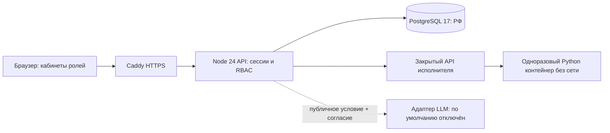

# Архитектура пилота

Локальный контур использует PGlite. Учебный Python выполняется в Pyodide/Web Worker с отдельной CSP; runtime поставляется локально, без CDN. Browser-результаты считаются непроверенными клиентскими данными и не создают оценку/свидетельство. Доступен согласованный SQL-export из работающего кабинета администратора.

Браузер работает с сервером одного происхождения, без CDN и внешних шрифтов. Пользовательский код не запускается процессом веб-приложения. Образ Python runner собирается отдельно. Docker daemon доступен только службе runner; для продуктивного исполнения использовать rootless daemon/отдельный узел, не обычный привилегированный сокет веб-приложения.

## Реестр данных

| Область | Таблицы |
|---|---|
| Программа | programs, competencies, indicators, courses, learning_units, prerequisites |
| Контингент и права | users, roles, user_roles, groups, group_members, enrollments, staff_scopes, expert_assignments |
| Аутентификация | sessions, login_limits |
| Содержание | tasks, task_versions, task_indicators |
| Учебные артефакты | hypotheses, artifacts, artifact_revisions, attempts, code_runs, comparisons, simulator_runs |
| Оценивание | reviews, evidence, grade_entries |
| Модели | mastery_snapshots, trajectory_decisions |
| Импорт | journal_sources, journal_observations |
| События | learning_events, audit_log, llm_interactions, notifications, appeals |
| Исследование | research_consents, research_experiments |

Некоторые таблицы — основа следующего этапа: research_experiments/consents, mastery_snapshots. В пилоте нет интерфейса назначения исследовательских групп или индивидуальной исследовательской выгрузки. История решений траектории уже записывается.

`artifact_revisions` добавляются новыми строками, API не редактирует старый код. Конфликт `baseVersion` возвращает HTTP 409. Изменение банка создаёт новую `task_versions`; исполнение использует версию, с которой была отправлена попытка. Транзакция преподавательской проверки создаёт отзыв, свидетельства, оценку, уведомление и аудит вместе. Технический администратор не имеет API выставления оценок.

Сессии: случайный токен, в БД только SHA-256, HttpOnly/SameSite=Strict/Secure в production, срок 8 часов. Пароли: scrypt N=32768,r=8,p=1, случайная соль, 64 байта. Учетные записи служебных ролей не активируются до назначения владельца. Внешний эксперт получает только назначенные артефакты на срок до 168 часов.

## Сохранённая модель beta-independent-v1

Для индикатора и целевого уровня берутся самостоятельные свидетельства с утверждённой связью, возрастом не более 180 дней. Из повторных попыток одной задачи остаётся последняя. При оценке `s∈[0,1]`: `α=1+Σs`, `β=1+Σ(1−s)`. Нижняя односторонняя 95% граница: `q₀.₀₅(Beta(α,β))`.

Рекомендация готовности: граница ≥0.8, не менее двух разных задач, положительная проверка переноса. Целевой продвинутый уровень не подтверждается базовой работой. При отсутствии данных Beta(1,1) — априорное распределение, а не измеренная вероятность способности. Начальный порог — исследовательская гипотеза и требует калибровки; дробные баллы являются приближёнными псевдонаблюдениями, а не доказанной психометрической моделью.

Старые узлы и рекомендательные ребра пилота сохранены в БД для совместимости. Новый прототип графа описан ниже; оптимизатор ИОТ не реализован. Черновые связи не блокируют просмотр сложного содержания. Решения о переводе на курс и официальной аттестации не автоматизируются.

## Источники контингента

ПМ26: шесть переданных журналов, 149 уникальных студентов в пределах групп. ПМ26-1…4: алгоритмы. ПМ26-5/6: введение в ИИ. ПМ25: 154 закрытые записи УМНИК, без копирования старых паролей. Группы ПМ25 не указаны в найденном источнике; создана явно предварительная группа. Принадлежность к ПМ25 следует постановке заказчика и требует сверки перед рабочим запуском.

1 833 непустые исходные отметки сохранены как `unclassified`, с дисциплиной, файлом, листом, ячейкой и хешем файла. Они не преобразованы в официальные оценки или самостоятельные свидетельства. Импорт не переносит исходные файлы в публичный репозиторий.

## Расширение схемы и модели 0.2

Миграция 004 дополняет 38 таблиц шестью: course_competencies, transition_rules, transition_inputs, control_outcomes, research_artifacts, elective_selections. Добавлены метаданные каталога, вид назначения и версия учебного ИИ-варианта. Старые попытки используют закреплённые task_versions; их код, проверки и оценки не переписываются при обновлении банка.

binary-transition-v1 использует только явно подтверждённые бинарные исходы: a=1+s, b=1+n−s. На каждый из m входов AND-правила выделяется δ/m, нижняя граница q_(δ/m)(Beta(a,b)) сравнивается с τ. Для сопоставимых семейств берётся первый допустимый исход в окне ≤180 дней, без замены успешным повтором; уровень совпадает точно, требуется успешный перенос. Общая верхняя оценка риска – min(1,Σ F_Beta(τ)). Независимость предпосылок для объединённой границы не нужна. Бюджет относится к одному решению; гарантия всей четырёхлетней траектории не заявляется. Сопоставимость, заранее назначенный контроль без отбора по результату, постоянство параметра и независимость исходов требуют отдельного протокола и калибровки.

Дробная legacy-модель выше сохранена для воспроизводимости. Её оценки нельзя смешивать с новым бинарным рядом. Обычная преподавательская оценка и browser_unverified не становятся бинарными исходами.

unit-level-structural-v1 строит наименьшее AND-замыкание утверждённых правил и всего конечного каталога кандидатов, выдавая нижнюю/верхнюю структурную границу. Цикл без опоры фактов не выводит. Элективы предварительно фиксируются: два из семи модулей, 21 состав. Факультативы включаются как назначенные дополнительные курсы. Полная модель ξ=(k,ℓ,σ,t,v) из статьи НГУ не заявляется реализованной: необходимы экспертная разметка индикаторов, сроков и версий, календари и сертификаты блокировок.

Все 208 правил – стартовые кандидаты. Междисциплинарное утверждение требует подтверждения порядка модулей. Правила и бинарная готовность дают рекомендации, официальную аттестацию не автоматизируют.
